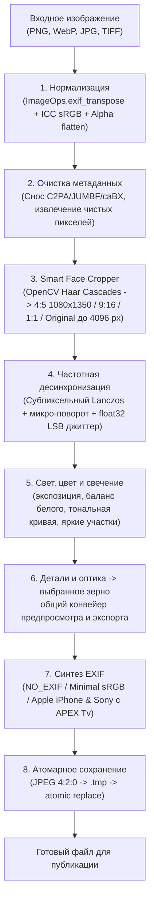

# 📸 Reelsator — Instagram AI Photo Optimizer & Provenance Sanitizer

[](https://www.python.org/)
[](https://microsoft.com/windows)
[-41CD52.svg)](https://qt.io/)
[]()
[](https://github.com/csezet/reelsator/actions/workflows/test.yml)
[](LICENSE)

**Reelsator** — высокопроизводительный инструмент для предпубликационной подготовки ИИ-сгенерированных изображений (ChatGPT Image, DALL-E, Midjourney, Stable Diffusion, Flux) под требования Instagram.

Программа выполняет комплексную очистку манифестов происхождения (C2PA / JUMBF / XMP), нормализацию цветовых профилей (Display-P3 $\to$ sRGB) и EXIF Orientation, кадрирование под стандарты Instagram, физическую симуляцию шумов сенсора камеры и инъекцию валидных структур EXIF мобильных камер (Apple iPhone 15/16 Pro).

Локальная версия **1.1.0** включает Flash-пресеты, настройку цвета и зерна, совпадающий с экспортом JPEG-предпросмотр и сохранение личных пресетов. Готовая сборка находится в `dist/Reelsator`; запуск из корня проекта — `run.bat`.

---

## 🔍 Инженерные задачи подготовки контента

1. **Санитизация метаданных C2PA и промптов**: Генераторы встраивают в JPEG (APP11/JUMBF) и PNG (`caBX`, `c2pa`, `tEXt`) сертификаты происхождения и текстовые промпты. Reelsator декодирует изображение в чистый пиксельный буфер с полной отсечкой метаданных, а также предоставляет побайтовый парсер для удаления сегментов на уровне контейнера.
2. **Управление цветом (Color Management)**: Приведение изображений из широких цветовых пространств (Display-P3, AdobeRGB) к стандартному sRGB через ICC-профилирование предотвращает искажение оттенков кожи.
3. **Нормализация EXIF Orientation**: Автоматический учет ориентации кадра перед очисткой контейнера исключает переворот вертикальных фото.
4. **Безопасная обработка прозрачности**: Автоматический композитинг альфа-канала PNG/WebP на нейтральный белый фон для предотвращения черных артефактов в JPEG.
5. **Физика оптики и сенсора (Sensor Grain & Optics)**: Устранение чрезмерной «пластиковой» гладкости диффузионных генераций за счет адаптивного пуассоновского шума, оптических микро-аберраций и виньетирования.
6. **Синтез EXIF мобильных камер**: Генерация синтаксически валидного профиля Apple iPhone с математически согласованными параметрами выдержки по стандарту APEX ($Tv = \log_2(1 / t)$).
7. **Атомарная запись**: Сохранение через временные файлы (`.tmp`) с последующим атомарным замещением (`os.replace`) защищает от битых файлов при прерываниях.

---

## 🛠️ Архитектура Pipeline



### Модули ядра (`core/`):
* **`core/c2pa_killer.py`**: Побайтовый парсер JPEG и PNG. Удаляет JUMBF/C2PA, IPTC `trainedAlgorithmicMedia`, XMP и текстовые промпты. Выполняет ICC-трансформацию цвета в sRGB и безопасный композитинг альфа-канала на выбранный фон (по умолчанию белый). Прозрачность `tRNS` в палитровых, RGB и серых PNG раскрывается в альфа-канал до масштабирования и преобразования цвета.
* **`core/smart_cropper.py`**: Интеллектуальное кадрирование по правилу третей с детекцией лиц через OpenCV Haar Cascades под форматы Instagram (**4:5 1080 × 1350 px**, 1:1, 9:16) либо сохранение исходных пропорций кадра с безопасным ранним масштабированием длинной стороны до 4096 px (например, 5000 × 2500 масштабируется до 4096 × 2048). Выполняется до оптической обработки, предотвращая избыточное выделение оперативной памяти на исходных сверхвысоких разрешениях (входной безопасный лимит — до 50 MP).
* **`core/watermark_disruptor.py`**: Субпиксельный ресэмплинг Lanczos, микро-поворот и субперцептивное возмущение младших бит (`float32`) для разрушения латентных периодических решеток.
* **`core/camera_optics.py`**:
  * **Шум сенсора (ISO Grain)**: адаптивная маска освещенности (зернистость выражена в тенях и полутонах, чистые света).
  * **Хроматические аберрации**: радиальный микро-сдвиг R/B каналов к краям кадра.
  * **Оптическая виньетка**: плавное падение освещенности к углам кадра ($cos^4$).
  * **Тональная калибровка Photonic Engine**: оптимизация контраста и теплоты тонов кожи.
  * **Нейтральная микротекстура**: симметричные изменения яркости в блоках 2×2 сохраняют разности RGB-каналов и средний цвет. Это художественная текстура; внутреннее имя Bayer сохранено для совместимости настроек.
* **`core/exif_spoofer.py`**: Управление структурами EXIF:
  * `NO_EXIF`: Полное отсутствие сегмента EXIF APP1 (чистый файл без метаданных съемки).
  * `MINIMAL`: Чистый технический профиль sRGB без фейковых дат и без идентификаторов софта.
  * `SYNTHETIC_CAMERA`: Синтез профилей реальных камер (iPhone 15 Pro, iPhone 16 Pro Max, Sony Alpha) с вычислением APEX ShutterSpeedValue ($Tv = \log_2(1 / t)$).
* **`core/pipeline.py`**: Пакетная очередь с безопасным созданием папок, защитой от перезаписи файлов (`resolve_unique_output_path`), кооперативной отменой и гарантией изоляции очереди.
* **`core/image_cache.py`**: Потокобезопасный LRU-кэш нормализованных исходников, ограниченный 64 МиБ. Изменение файла, фона прозрачности или режима раннего масштабирования приводит к загрузке нужной версии исходника. Изображения, превышающие бюджет кэша, обрабатываются без помещения в кэш.
* **`core/photo_effects.py`**: Экспозиция и относительный баланс белого в линейном свете, насыщенность, монотонная S-кривая, подъём чёрного, мягкая компрессия светов и свечение по маске ярких участков. Цвет и свечение вычисляются в `float32` до округления в 8-битный RGB. Художественное зерно разделено на яркостную и цветную составляющие с независимыми случайными потоками.
* **`core/user_presets.py`**: Личные рецепты обработки в JSON с версией схемы, проверкой типов и диапазонов и атомарным сохранением. Файл располагается в `%APPDATA%/Reelsator/presets.json`, отдельно от установки. Случайный seed файла, дата съёмки и разрешение перезаписи не входят в рецепт.

### Предпросмотр и экспорт

Предпросмотр и сохранение используют один конвейер обработки на полном разрешении экспорта и один JPEG-кодировщик. Загрузка и нормализация исходников выполняются в фоновом потоке. За каждым файлом закрепляется случайный seed на время текущего сеанса приложения; явно заданный `random_seed` сохраняет приоритет.

В сравнении «До/После» показан один и тот же кадр после кадрирования. Режим **После JPEG** включён по умолчанию и показывает декодированную версию итогового JPEG; переключение на вариант до сжатия не запускает обработку заново. Ползунок качества JPEG влияет и на предпросмотр, и на сохранение. **Вписать** показывает кадр целиком, а **100%** соответствует одному пикселю изображения на один физический пиксель экрана; большие кадры доступны через полосы прокрутки.

При изменении настроек старый результат скрывается до готовности новой версии. Во время пакетного экспорта настройки фиксируются до завершения или отмены партии.

### Свет, цвет и зерно

В блоке **Свет и цвет** доступны следующие настройки:

| Настройка | Диапазон | Нейтральное значение |
|---|---|---|
| Экспозиция | −3…+3 EV | 0 EV |
| Температура / оттенок | −100…+100% | 0% |
| Насыщенность | 0…200% | 100% |
| S-кривая (контраст) | −100…+100% | 0% |
| Подъём чёрного | 0…15% | 0% |
| Смягчение светов | 0…100% | 0% |
| Свечение светов | 0…100% | 0% |
| Радиус свечения | 1…60 px | 12 px; применяется при включённом свечении |

Температура и оттенок — относительные художественные поправки; они не задают температуру в кельвинах. Нейтральные значения сохраняют исходные пиксели. Смягчение светов применяется до ограничения яркости, чтобы сохранить переходы при положительной экспозиции; свечение использует плавную маску ярких участков.

В блоке **Зерно** выбирается один режим: прежнее сенсорное зерно или новое художественное. Художественный режим позволяет независимо задавать яркостную силу (0…12 условных единиц), цветную силу (0…24) и размер зерна (1…4 px). Диапазон цветной составляющей расширен для выраженного Digicam-эффекта: JPEG 4:2:0 заметно сглаживает мелкий цветной шум. Значения прежних настроек не пересчитываются. При смене режима настройки обоих вариантов сохраняются. Зерно накладывается после масштабирования и обработки деталей, перед JPEG-кодированием; его размер задаётся в пикселях итогового изображения. Установка обеих сил в 0 отключает художественное зерно.

Порядок обработки: нормализация → кадрирование → частотные изменения → прежняя тональная калибровка (если включена) → свет, цвет и свечение → микротекстура, локальный контраст и оптика → выбранное зерно → JPEG. Пять прежних пресетов используют нейтральные значения новых настроек и прежний режим зерна. Soft Flash и Digicam Flash используют собственную цветовую настройку и художественное зерно.

---

## ⚡ Пресеты обработки

| Пресет | Назначение | Особенности |
|---|---|---|
| **Soft Flash** | Мягкий стиль фото со вспышкой | Тёплый приглушённый цвет, мягкие света, мелкое преимущественно яркостное зерно; JPEG 94 |
| **Digicam Flash** | Выраженный стиль цифровой компактной камеры | Более яркий контрастный кадр, умеренное усиление деталей и заметное цветное зерно; JPEG 96 |
| **OFM Master** *(Рекомендуемый)* | Основной сбалансированный профиль | iPhone 15 Pro, умный кроп 4:5, натуральное зерно сенсора |
| **Микротекстура и локальный контраст (ISP)** | Детализация и текстура изображения | Нейтральная текстура яркости без цветового сдвига, микро-контраст ISP |
| **iPhone Natural** | Портреты крупным планом, дневные фото | Минимальное вмешательство, iPhone 16 Pro Max, чистый цвет |
| **Story / Reels** | Истории и вертикальные публикации | Кадрирование 9:16 (1080 × 1920 px) |
| **Strong Processing** | Глубокая оптическая обработка | Усиленное частотное возмущение, выраженная оптика |
| **Оригинальные пропорции (до 4096 px)** | Без изменения геометрии кадра | Сохраняет исходные пропорции кадра (с безопасным ранним масштабированием длинной стороны до 4096 px для защиты RAM) |

### Личные пресеты и редактирование

В блоке **Мои пресеты** нажмите **Сохранить как…** и задайте название. Выбранный личный пресет можно изменить и сохранить кнопкой **Обновить** либо удалить. Повторяющееся название при сохранении нового пресета не заменяет прежний рецепт. После перезапуска сохранённые рецепты доступны в списке; выбор пресета применяет его к предпросмотру и всей партии.

Название текущего пресета закреплено над панелью настроек. При правках появляется пометка **изменён**, а подсветка встроенного пресета снимается. **Сбросить** возвращает настройки выбранного рецепта. Ползунки силы микротекстуры и усиления деталей доступны при включении соответствующего эффекта; выключение сохраняет выбранную силу. Неактивные настройки отображаются приглушённо. Верхний индикатор EXIF показывает фактически выбранный режим.

Файл личных рецептов: `%APPDATA%\Reelsator\presets.json`. Его можно скопировать для переноса на другой компьютер. Он сохраняется при замене папки приложения. Формат не включает seed текущего файла, дату съёмки, разрешение перезаписи или папку вывода. При повреждении файла приложение показывает ошибку и блокирует запись пресетов, сохраняя исходный файл; встроенные пресеты продолжают работать.

### Примеры Flash-пресетов

Два новых пресета подобраны по визуальным признакам предоставленных референсов: спокойное почти монохромное зерно первого фото и выраженный цветной шум второго и третьего. Это приближение к стилю, а не точный пресет авторов. Освещение исходника, поза, макияж и ретушь также влияют на результат. Обработка цвета не создаёт геометрию настоящей вспышки и её тени; лучший исходник уже содержит такой свет.

В [examples/flash-presets](examples/flash-presets/README.md) сохранены чистый синтетический портрет, два JPEG-экспорта и сравнение с фрагментами 100%. Результаты получены конвейером приложения с фиксированным seed 1729; совпадение предпросмотра с экспортом проверяется автоматически. Повторить на этом или своём исходнике:

```powershell
.\.venv\Scripts\python.exe scripts/preview_flash_presets.py
.\.venv\Scripts\python.exe scripts/preview_flash_presets.py --input "C:\Photos\portrait.png" --output-dir "C:\Photos\flash-comparison"
```

Скрипт создаёт новую папку; повторный запуск сохраняет предыдущие результаты и добавляет суффикс к папке. Исходное изображение сохраняется. При работе в интерфейсе выберите пресет и проверьте зерно в режиме **100% / После JPEG**. Для уже яркого кадра начните с уменьшения экспозиции пресета. Flash-пресеты по умолчанию сохраняют минимальный технический EXIF без вымышленных данных камеры. Их художественная обработка не гарантирует изменения метки ИИ на платформе.

---

## 💾 Системные требования и потребление памяти

* **Операционная система**: Windows 10 / 11 (64-bit).
* **Оперативная память (RAM)**: минимум 4 ГБ (рекомендуется 8 ГБ+ для пакетной обработки сверхвысоких разрешений).
* **Безопасный лимит разрешения**: до 50 Мегапикселей (50 MP). Файлы, превышающие 50 MP, отклоняются защитным шлюзом с информативным сообщением об ошибке для предотвращения Out-Of-Memory.
* **Замеренное пиковое потребление RAM (Windows, режим Original)**:
  * 12 MP (4000 × 3000): ~962 МБ пик, ~7.8 с
  * 24 MP (6000 × 4000): ~896 МБ пик, ~9.6 с
  * 48 MP (8000 × 6000): ~1008 МБ пик, ~7.2 с (с ранним даунскейлом до 4096 px)

---

## 📋 Протокол приёмочного тестирования Windows (Acceptance Protocol)

Каждая релизная сборка проходит проверку по следующим приёмочным сценариям:
1. **Запуск без зависимостей**: распаковка `Reelsator-windows-x64.zip` и запуск `Reelsator.exe` на чистой системе Windows без установленного Python.
2. **Проверка C2PA & IPTC**: подача сгенерированных фото Midjourney / ChatGPT / DALL-E $\to$ валидация выходного файла через внешний верификатор `c2patool` (манифест C2PA полностью отсутствует).
3. **Прозрачность PNG (tRNS)**: загрузка палитрового PNG с альфа-каналом $\to$ чистый композитинг на нейтральный белый фон без темных ореолов.
4. **Нормализация ориентации**: файл с тегом EXIF Orientation=6 (поворот на 90° CW) корректно ориентируется вертикально в интерфейсе и в выходном JPEG.
5. **Масштабирование Original**: файл 5000 × 2500 px сохраняет соотношение 2:1 и масштабируется до 4096 × 2048 px без переполнения памяти.
6. **Кооперативная отмена и закрытие**:
   * При отмене партии по кнопке «Отмена» завершается запись текущего файла, остальные файлы очереди не повреждаются.
   * При закрытии окна во время активного предпросмотра или пакетной партии окно блокирует повторные клики и запуск новых задач, кооперативно ожидает завершения воркеров и закрывается без оставления временных файлов `.tmp`.

---

## 🚀 Установка и запуск

### Локальная сборка 1.1.0 (Portable для Windows):

Запустите `run.bat` или `dist/Reelsator/Reelsator.exe`. Для переноса используйте архив `dist/Reelsator-v1.1.0-windows-x64.zip` либо всю папку `dist/Reelsator` вместе с `_internal`. Python устанавливать не требуется. `run_dev.bat` запускает исходники через локальное окружение разработки.

### Ранее опубликованный релиз:
Скачайте готовый архив из [GitHub Releases v1.0.1](https://github.com/csezet/reelsator/releases/tag/v1.0.1):
1. Скачайте `Reelsator-v1.0.1-windows-x64.zip`.
2. Распакуйте архив в любую папку.
3. Запустите `Reelsator.exe` (установка Python не требуется).

### Требования для разработки:
* Python 3.10+
* Windows 10 / 11

### Установка для разработки (Development):
```bash
git clone https://github.com/csezet/reelsator.git
cd reelsator
pip install -r requirements.txt
```

### Воспроизводимая сборка (Reproducible Lockfile Install):
```bash
# Точно зафиксированные версии зависимостей
pip install -r requirements-lock.txt
```

### Запуск приложения:
```bash
python app.py
```

### Запуск тестов:
```bash
python -m unittest discover tests -v
```

### Сборка автономного .exe:
```bash
pip install -r requirements-lock.txt
pip install -r requirements-dev-lock.txt
python build_exe.py
```
Сборка выполняется во временной папке внутри `build`. Перед заменой дистрибутива сценарий запускает **собранный .exe** с `--smoke-test`: проверяет ресурсы, обе каскадные модели OpenCV, режимы EXIF, кнопки Flash-пресетов, совпадение JPEG-предпросмотра с экспортом и сохранение личного рецепта. При успехе прежняя папка переносится в `dist/backups`, а новая — в `dist/Reelsator`. При ошибке переноса прежняя папка восстанавливается.

Окружение сборки ограничивает поиск DLL каталогами активного Python и Windows, чтобы одноимённые библиотеки из сторонних инструментов в `PATH` не попадали в пакет. Проверка готового `.exe` выполняется с `PATH`, содержащим только каталоги Windows. Системное окружение пользователя не изменяется.

Дополнительно создаются переносимый ZIP и файл `.build.json` с версией, контрольными суммами, путём резервной копии и результатом проверки. JSON-отчёт нужен и для оконного `.exe`, у которого нет консоли. Повторная сборка не перезаписывает прежний ZIP, а добавляет суффикс к имени. Автоматическая проверка сборки также предусмотрена в GitHub Actions (`.github/workflows/test.yml`).

---

## 📄 Лицензия
MIT License.
Автор: [csezet](https://github.com/csezet)
