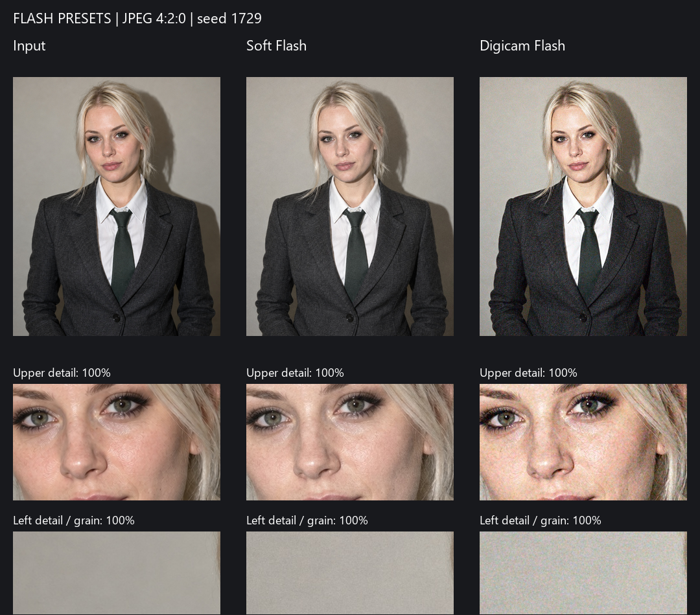

# Примеры Soft Flash и Digicam Flash

`source.png` — новый вымышленный портрет взрослой женщины, созданный встроенным ImageGen для проверки обработки. Это синтетическое тестовое изображение, не оригинал авторов Instagram и не копия человека из референсов. Исходник имеет свет прямой вспышки, тень на стене, светлые волосы, тёмную ткань и участки ровного фона. Обработка пресетами выполнена кодом Reelsator, без генеративной перерисовки.

## Результаты

В папке `results`:

- `source-framed.jpg` — исходный кадр после общего кадрирования 4:5, без эффектов, JPEG 96.
- `soft-flash.jpg` — окончательный JPEG Soft Flash.
- `digicam-flash.jpg` — окончательный JPEG Digicam Flash.
- `comparison.png` — три кадра и одинаковые фрагменты в масштабе 100%.
- `report.json` — настройки, seed, размеры, контрольные суммы и результат проверки совпадения предпросмотра с экспортом.



Сравнение использует декодированные JPEG. Верхний ряд вписан в область просмотра; нижние фрагменты показаны без масштабирования. На другом исходнике эти же фиксированные области могут попадать на другие детали.

## Выбранные настройки

| Настройка | Soft Flash | Digicam Flash |
|---|---|---|
| Экспозиция | +0.25 EV | +0.45 EV |
| Температура / оттенок | +12% / 0% | −4% / −3% |
| Насыщенность | 84% | 92% |
| Контраст кривой | −8% | +22% |
| Подъём чёрного | 1.8% | 0.4% |
| Смягчение светов | 40% | 55% |
| Свечение / радиус | 3% / 14 px | 6% / 8 px |
| Яркостное / цветное зерно | 4 / 0.6 | 7 / 18 |
| Размер зерна | 1.1 px | 1.3 px |
| Усиление деталей ISP | выключено | 0.18 |
| JPEG | 94, 4:2:0 | 96, 4:2:0 |

Подбор опирается на предоставленные обработанные фото. Оригиналы до обработки и точные настройки авторов недоступны. Первый стиль мягче и почти без цветного шума; второй ярче и с заметным цветным зерном. Глобальный фильтр не воспроизводит позу, макияж, ретушь лица или новое направление света. Для пересвеченного исходника следует снизить экспозицию. Эти эффекты не доказывают происхождение изображения и не обещают снятие метки ИИ.

## Воспроизведение

Из корня проекта:

```powershell
.\.venv\Scripts\python.exe scripts/preview_flash_presets.py
```

Для своего исходника:

```powershell
.\.venv\Scripts\python.exe scripts/preview_flash_presets.py --input "C:\Photos\portrait.png" --output-dir "C:\Photos\flash-comparison" --seed 1729
```

При повторном запуске создаётся новая папка `results-2`, `results-3` и т. д.; прежние результаты и исходник не перезаписываются. Один seed фиксирует шум для воспроизводимого сравнения. В приложении seed закрепляется за файлом на время сеанса.

## Создание тестового исходника

Режим: встроенный ImageGen, новая генерация. Итоговый исходник сохранён как `examples/flash-presets/source.png`. Точный промпт:

```text
Use case: photorealistic-natural. Asset type: clean calibration photograph for a deterministic photo-editing program. Generate one neutral, ungraded vertical 4:5 waist-up photographic portrait of an unmistakably adult woman aged 27 with light platinum-blonde hair, subtle dark eye makeup, and natural skin texture. She is fully clothed in a buttoned white collared shirt, charcoal gray jacket and muted dark green necktie. Plain neutral gray-beige wall behind her. Near-camera direct flash produces a real-looking defined shadow on the wall to her right, with gentle fill so facial detail remains visible. Straightforward candid camera framing, subject looking toward camera, hair strands and fabric detail in focus. Neutral white balance, restrained normal saturation, clean low-noise capture, no added grain, no retro filter, no glow, no color grade, no beauty smoothing, no artificial sharpening. Keep fair skin and pale hair well exposed with preserved highlight detail, and include both dark fabric and smooth wall areas for noise inspection. This is a new fictional adult subject, not a likeness of any reference person. No text, no logos, no watermark.
```
